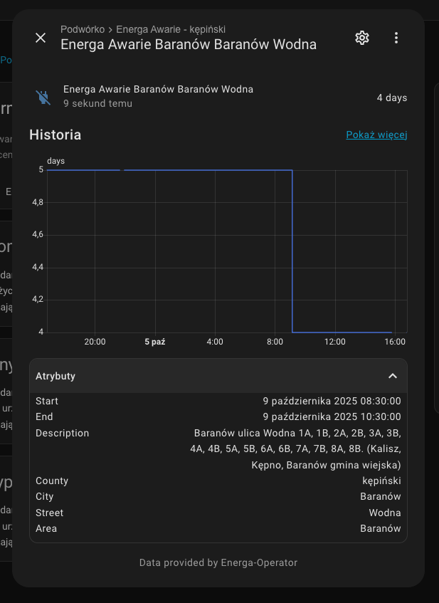
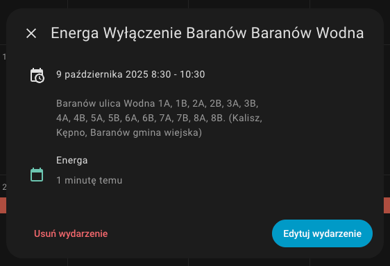

# Energa Awarie (Home Assistant)

Integracja monitoruje **planowane wyłączenia** i **bieżące awarie** Energa Operator dla wybranej lokalizacji (powiat, gmina, opcjonalnie miasto i ulica).

Fork rozwojowy ([Flower7C3](https://github.com/Flower7C3/energa_awarie)) na bazie [chauek/energa_awarie](https://github.com/chauek/energa_awarie). Docelowo część zmian trafi do upstream.

**English summary:** [README.en.md](README.en.md) · **Blueprinty:** [docs/BLUEPRINTS.md](docs/BLUEPRINTS.md)

## Funkcje (od 1.2.0)

| Encja | Typ | Znaczenie |
|-------|-----|-----------|
| **Awaria aktywna** | `binary_sensor` (`problem`) | Trwa awaria — widoczna też w panelu HA **`/maintenance`** (jak Librus *grade_risk*) |
| **Wyłączenie planowane** | `binary_sensor` (`problem`) | Włączone, gdy **trwa** planowe wyłączenie — też na **`/maintenance`** |
| **Planowane wyłączenie** | `sensor` (dni) | Dni do najbliższego planu + atrybut `outages` (lista) — feed planowanych |

Dodatkowo:

- **Rekonfiguracja** wpisu (powiat → gmina/miasto z API Energi) — **jedno urządzenie na wpis** (`entry_id`, nie slug lokalizacji).
- **Lista powiatów** z wyszukiwaniem; podpowiedzi gmin/miast z JSON operatora.
- **Kalendarz** (opcjonalnie): wydarzenia z planowanych wyłączeń.
- **Blueprinty** automatyzacji powiadomień (HACS → Integracja → Blueprinty, lub edytor automatyzacji).

## Instalacja

### HACS (zalecane)

1. Dodaj repozytorium jako [niestandardowe](https://hacs.xyz/docs/faq/custom_repositories/) (typ: **Integration**):
   - `https://github.com/Flower7C3/energa_awarie` (fork z patchami), albo
   - `https://github.com/chauek/energa_awarie` (upstream — starszy zestaw funkcji).
2. Zainstaluj **Energa Awarie** i zrestartuj Home Assistant.

### Ręczna

Skopiuj `custom_components/energa_awarie` do `config/custom_components/`, restart.

## Konfiguracja

**Ustawienia → Urządzenia i usługi → Dodaj integrację → Energa Awarie**

1. Wybierz **powiat** (lista).
2. **Gmina** (wymagana), **miasto** / **ulica** (opcjonalnie).
3. **Kalendarz** (opcjonalnie).

Jedna konfiguracja = jedno urządzenie z dwoma encjami. Unikalność: `powiat + gmina + miasto + ulica`.

Po aktualizacji z wersji „jeden sensor” usuń starą encję z rejestru, jeśli została sierotą.

## Źródła danych

| Feed | URL HTML | Zastosowanie |
|------|----------|----------------|
| Planowane | [wylaczenia-planowane](https://energa-operator.pl/uslugi/awarie-i-wylaczenia/wylaczenia-planowane) | Sensor planowanych |
| Bieżące | [wylaczenia-biezace](https://energa-operator.pl/uslugi/awarie-i-wylaczenia/wylaczenia-biezace) (`nPrMap2024` / `data-shutdowns`) | Binary awarii aktywnej |

Strona oddziału (np. `/wylaczenia-biezace/torun`) to ten sam JSON z filtrem `dept` w UI — integracja filtruje po lokalizacji w HA, nie po całym oddziale.

## Blueprinty i alerty

Gotowe szablony w:

`custom_components/energa_awarie/blueprints/automation/`

- **Awaria aktywna** — `persistent_notification` + opcjonalny krok notify.
- **Planowane wyłączenie blisko** — próg dni.
- **Koniec awarii** — usuwa powiadomienie.

Import: **Ustawienia → Automatyzacje → Utwórz automatyzację → Importuj blueprint** (lub wybór z listy po instalacji integracji).

Panel **Energy** (`/energy/electricity`) nie obsługuje alertów wyłączeń — tylko statystyki zużycia (np. osobna integracja licznika). Alerty: blueprinty lub własne automaty.

## Wdrożenie z monorepo `t630`

```bash
rsync -a --delete --exclude __pycache__ \
  github/energa_awarie/custom_components/energa_awarie/ \
  opt/homeassistant/config/custom_components/energa_awarie/
```

## Zrzuty (upstream)

  


## Licencja

MIT (jak upstream).